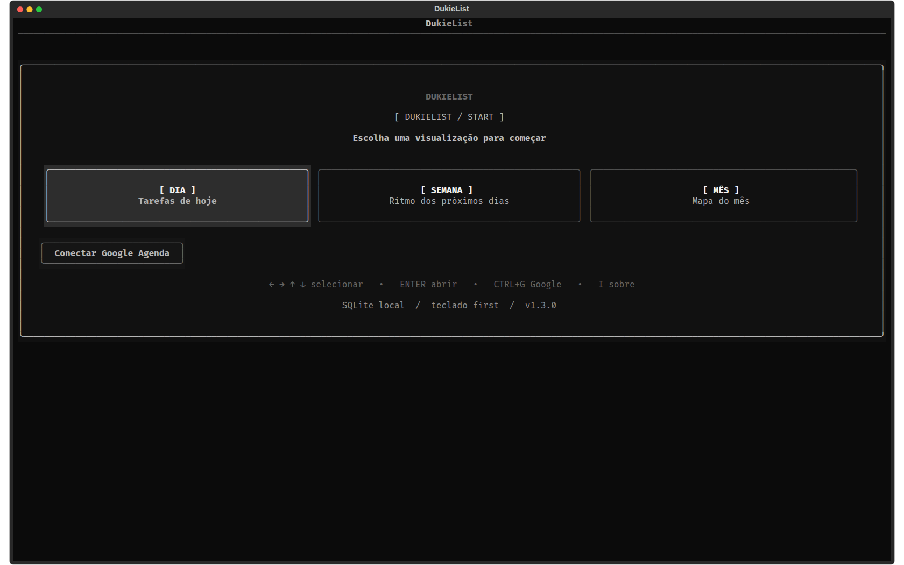
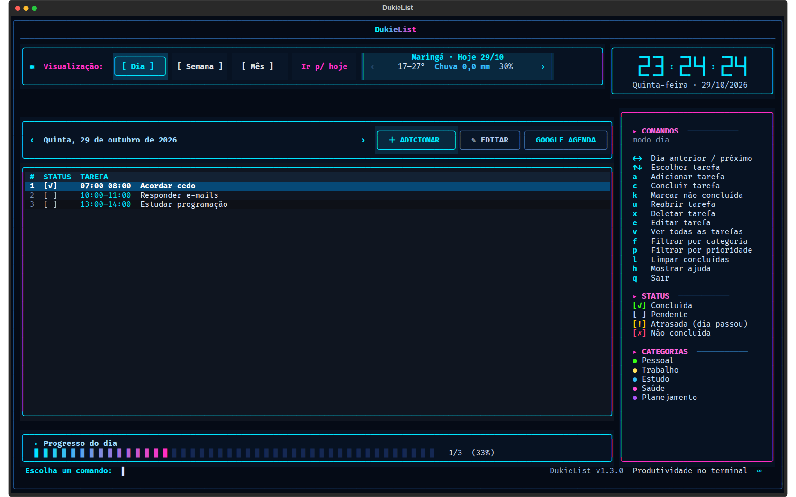
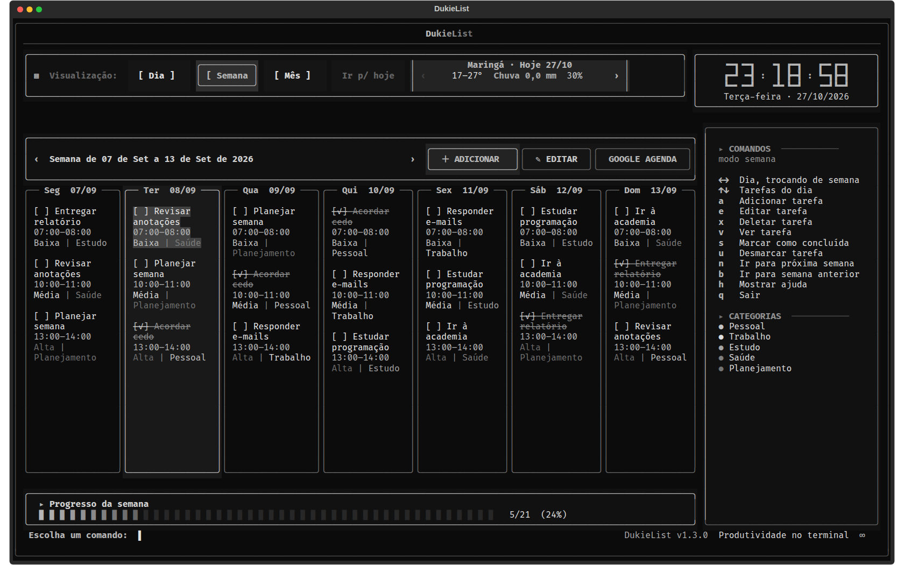
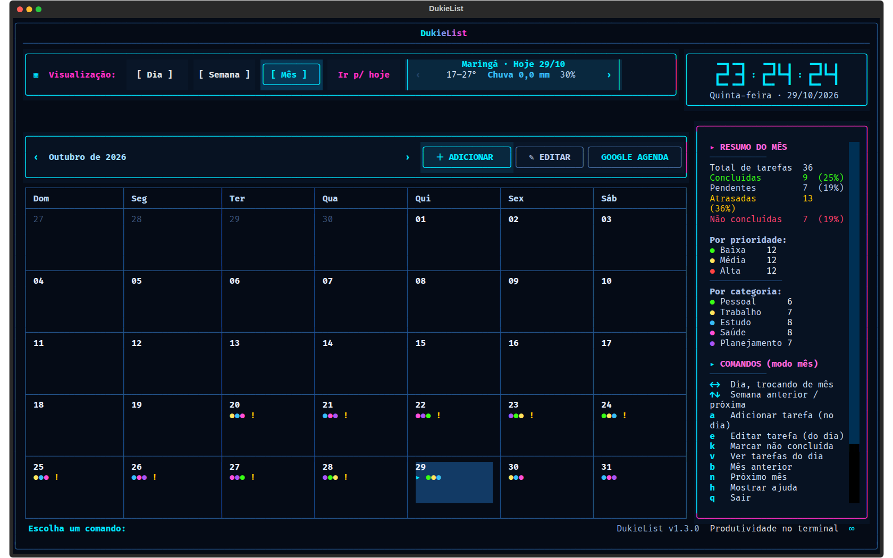
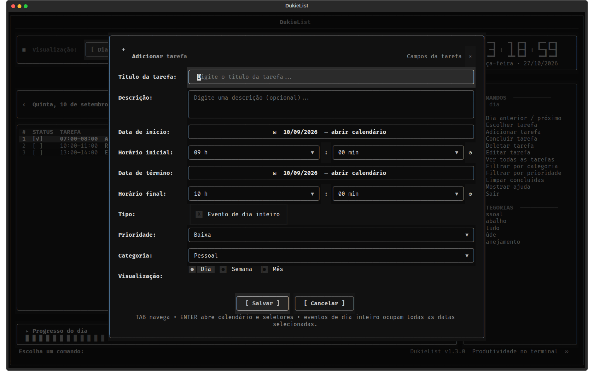
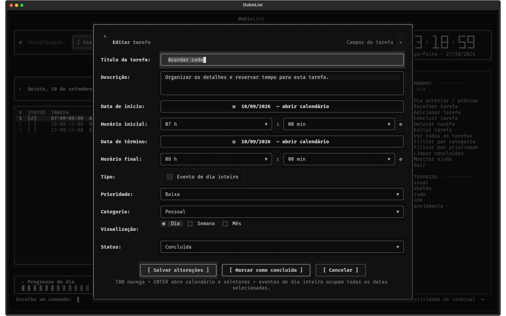

# DukieList

O DukieList é uma todo list TUI (Terminal User Interface) para organizar tarefas do dia a dia diretamente no terminal. A interface foi feita em Python com Textual, usa uma estética cyberpunk discreta e guarda tudo em um banco SQLite local.

Versão atual: **1.3.0**. O comando de terminal é `dukielist`; o módulo Python e os caminhos de dados e configuração ainda usam `dukielist`.

## Screenshots

As imagens abaixo foram geradas a partir da aplicação em um terminal de 168 colunas × 52 linhas usando dados de demonstração, seguindo a composição visual das referências.

### Tela inicial — escolha do modo



### Visão diária



### Visão semanal



### Visão mensal



### Modal de adicionar tarefa



### Modal de editar tarefa



## O que pode ser feito

- Escolher Dia, Semana ou Mês na abertura e trocar de modo a qualquer momento.
- Criar tarefas com título, descrição, data e horário de início e término, prioridade, categoria, status e modo de visualização após salvar.
- Marcar eventos como **dia inteiro** para ocupar todo o intervalo selecionado.
- Escolher as datas em calendários completos e definir início e término em seletores de horário.
- Editar qualquer tarefa selecionada e alterar todos os seus campos.
- Concluir e reabrir tarefas.
- Ver um **`[!]` amarelo** no lugar do `[ ]` quando o dia da tarefa passa e ela continua pendente, e registrar depois se ela foi concluída ou **não concluída**.
- Excluir tarefas com confirmação.
- Filtrar por texto, categoria, prioridade e status; usar `V` para limpar filtros e ver todas as tarefas.
- Navegar para o dia, a semana ou o mês anterior e seguinte, pelas setas do teclado ou pelos atalhos `N` e `B`.
- Consultar percentual de conclusão, total, pendentes, atrasadas, não concluídas e distribuição por categoria.
- Usar o calendário mensal para selecionar um dia e ver as tarefas daquele dia.
- Manter a semana inteira visível, com barra de rolagem nas colunas que excederem o espaço disponível.
- Ajustar o calendário à altura do terminal para que todos os dias do mês vigente permaneçam na tela.
- Continuar vendo os dados após fechar e abrir o aplicativo: o SQLite é carregado automaticamente.
- Sincronizar cartões do Trello com prazo, sem duplicar tarefas em execuções futuras.
- Espelhar as tarefas no Google Calendar e ver no DukieList os compromissos da agenda, nos dois sentidos.
- Ver a previsão do tempo da localização aproximada atual no cabeçalho, com setas para hoje e mais três dias, incluindo chuva estimada em mm.

A faixa principal mantém a marca **DukieList**. As abas de visualização dividem o cabeçalho com a previsão do tempo e um relógio **digital HH:MM:SS**, atualizado a cada segundo, com o dia da semana e a data. O relógio usa o horário local da máquina. Pressione **`I`** para abrir **Sobre**.

A composição segue as referências: marca em gradiente, abas, painéis com bordas ciano/magenta, sete colunas semanais, calendário com divisórias e indicadores coloridos, barra de progresso em gradiente e formulários com campos alinhados. A aparência final depende da fonte e do suporte a cores do terminal; efeitos gráficos de brilho e tipografia dos mockups não são reproduzidos pixel a pixel em uma TUI.

Para o layout completo, use cerca de **168×52** ou mais. Também há navegação testada em **140×44, 100×36 e 80×30**. Abaixo de 160 colunas, a previsão compacta é ocultada, mas continua acessível pelo atalho `R`. Em telas estreitas, a lateral é recolhida (a ajuda continua em `H`), a semana acompanha o dia selecionado mostrando três ou uma coluna, e formulários/calendário usam rolagem. Em telas baixas, o relógio é compacto e o progresso é ocultado para preservar as tarefas. Redimensionar não modifica seus dados.

No modo Semana, a grade mostra a semana fechada, de segunda a domingo. `← →` escolhem o dia e, nas pontas, atravessam para a semana vizinha: avançar no domingo abre a semana seguinte já na segunda-feira, e voltar na segunda abre a semana anterior no domingo. O título do período, o progresso e a lateral acompanham a troca. `↑ ↓` percorrem todas as tarefas do dia selecionado — inclusive as que não cabem de uma vez. `A` cria no dia selecionado; `ENTER` edita a tarefa ou abre a criação se o dia estiver vazio. No calendário, `ENTER` abre a lista do dia selecionado.

## Status das tarefas

A coluna `STATUS` e os cartões da semana mostram, entre colchetes, em que pé está cada tarefa:

| Marcador | Status | Quando aparece |
| --- | --- | --- |
| `[ ]` | Pendente | A tarefa ainda está dentro do prazo. |
| `[✓]` | Concluída | Você marcou a tarefa como feita. |
| `[!]` | Atrasada | **Automático**: o último dia da tarefa passou e ela continua pendente. |
| `[✗]` | Não concluída | Você registrou que a tarefa não foi feita. |

O `[!]` é calculado pela data, não guardado no banco: assim que o dia vira, toda tarefa pendente
que ficou para trás passa a aparecer em amarelo, sem precisar reabrir o aplicativo. Ele é um
lembrete de que falta uma decisão, e some quando você resolve a pendência de um dos dois jeitos:

- `S` (ou **[ Marcar como concluída ]** no card de edição) para dizer que você conseguiu concluir.
- `K` (ou **[ Marcar como não concluída ]** no card de edição) para registrar que não concluiu.

O status **Não concluída** também está na lista do campo `Status:` do card de edição e no filtro de
status (`F` abre o filtro). Tarefas não concluídas ficam no histórico: `L` (limpar concluídas)
remove apenas as concluídas. Em tarefas de vários dias, o `[!]` só aparece depois que o **último**
dia do intervalo passa. No calendário do modo Mês, onde não cabe um marcador por tarefa, os dias
com tarefas atrasadas ou não concluídas ganham um `!` ao lado dos pontos de categoria.

Para quem usa as integrações: Trello e Google Agenda só conhecem *feito* e *não feito*, então uma
tarefa **Não concluída** chega lá como não feita. O DukieList guarda o status completo e não deixa
uma leitura remota de "não feito" rebaixar a sua marcação de volta para *pendente*.

## Navegação pelo teclado

As setas funcionam em toda a agenda e o que elas fazem depende de onde está o foco.

| Onde está o foco | `← →` | `↑ ↓` |
| --- | --- | --- |
| Tela inicial | Escolher Dia, Semana ou Mês | Escolher Dia, Semana ou Mês |
| Modo Dia | Dia anterior / seguinte | Escolher a tarefa da lista |
| Modo Semana | Dia anterior / seguinte, trocando de semana nas pontas | Tarefas do dia selecionado |
| Modo Mês | Dia anterior / seguinte, trocando de mês nas pontas | Semana anterior / seguinte |
| Abas de visualização | Trocar de aba | `↓` entra na visualização ativa |
| Previsão do tempo | Dia anterior / seguinte da previsão | `↓` entra na visualização, `↑` volta às abas |
| Botões do período | Período anterior / seguinte | `↓` entra na visualização, `↑` volta às abas |

Nenhuma seta fica presa em um extremo: o cursor sempre atravessa para a semana ou o mês
vizinho em vez de voltar ao começo do período. `TAB` e `SHIFT+TAB` continuam movendo o foco
entre os controles, e `T` volta para hoje em qualquer modo.

## Atalhos

| Tecla | Ação |
| --- | --- |
| `D` | Modo Dia |
| `W` | Modo Semana |
| `M` | Modo Mês |
| `T` | Ir para a data de hoje em qualquer modo |
| `R` | Abrir a previsão do tempo |
| `A` | Adicionar tarefa |
| `E` | Editar tarefa selecionada |
| `C` | Concluir ou reabrir tarefa |
| `S` / `U` | Marcar como concluída / desmarcar |
| `K` | Marcar como não concluída |
| `X` / `DELETE` | Excluir tarefa com confirmação |
| `F` / `P` | Filtrar por categoria / prioridade |
| `L` | Limpar tarefas concluídas do período (não remove as não concluídas) |
| `V` | Ver tarefas; limpa filtros ativos |
| `N` / `B` | Próximo período / período anterior, em todos os modos |
| `CTRL+G` | Conectar ou sincronizar a Google Agenda |
| `I` | Abrir a tela Sobre |
| `← →` | Dia anterior / seguinte; nas pontas, troca a semana e o mês |
| `↑ ↓` | Tarefas da lista; no calendário, semana anterior / seguinte |
| `TAB` / `SHIFT+TAB` | Avançar ou voltar o foco entre controles |
| `ENTER` | Selecionar, abrir ou confirmar |
| `ESC` | Fechar modal |
| `H` / `?` | Mostrar ajuda completa |
| `Q` | Sair |

Nos formulários, `CTRL+S` salva de qualquer campo; `S` também salva quando o foco não está em um campo de texto. Pressionar `ENTER` em um campo de texto também envia o formulário.

No formulário, **Data de início** e **Data de término** abrem calendários. Use `← →` para mudar
o dia, `↑ ↓` para mudar a semana, `Page Up` / `Page Down` para trocar o mês, `T` ou `Home`
para voltar a hoje e `ENTER` para escolher. Desmarque **Evento de dia inteiro** para definir
os horários de início e término; use `TAB`, `ENTER` e as setas para navegar pelos seletores.
O término precisa ser posterior ao início. Eventos de dia inteiro ocupam todas as datas do
intervalo, inclusive a data de término.

## Requisitos no Ubuntu

- Ubuntu 24.04 ou mais recente para os comandos de instalação abaixo (em versões anteriores, instale primeiro Python 3.11+).
- Python 3.11 ou mais recente.
- `python3-venv` e `python3-pip`.
- Um terminal com suporte a UTF-8 e cores ANSI/TrueColor.

## Baixar o projeto

Com Git instalado, clone o repositório e entre na pasta:

```bash
git clone https://github.com/LeandroDukievicz/dukielist.git
cd dukielist
```

Se você recebeu a pasta por ZIP ou já está trabalhando no diretório do projeto, pule esta seção.

Instale os pacotes básicos:

```bash
sudo apt update
sudo apt install -y git python3 python3-venv python3-pip
```

## Instalação a partir da pasta baixada

Dentro da pasta clonada:

```bash
cd dukielist  # omita se já estiver dentro da pasta clonada
chmod +x scripts/install.sh
./scripts/install.sh
```

O instalador cria o ambiente virtual `.venv`, instala o pacote em modo editável, cria o comando `dukielist` em `~/.local/bin` e cria o atalho `DukieList.desktop` na Área de Trabalho.

Se `dukielist` não for encontrado no terminal atual, abra um novo terminal ou rode:

```bash
export PATH="$HOME/.local/bin:$PATH"
```

Para instalar manualmente, sem o script:

```bash
cd dukielist  # omita se já estiver na pasta
python3 -m venv .venv
source .venv/bin/activate
python -m pip install -e .
```

## Como executar

Depois da instalação, o comando global é:

```bash
dukielist
```

Ou, a partir da pasta do projeto e sem depender do `PATH`:

```bash
./.venv/bin/dukielist
```

Também é possível executar como módulo ou passando um SQLite alternativo:

```bash
python -m dukielist
dukielist --db /caminho/para/meu-dukielist.db
```

Para fechar o programa, pressione `Q` ou `CTRL+C`.

## Previsão do tempo

Ao entrar na agenda, o DukieList detecta a **cidade aproximada pelo IP público** e carrega a
previsão no cabeçalho; enquanto o programa estiver aberto, atualiza a localização e a previsão
a cada 30 minutos. O IP público é enviado ao GeoJS para a detecção, mas não é salvo no banco
do DukieList. Por não usar GPS, a cidade pode estar errada
quando houver VPN, proxy ou imprecisão do provedor de internet.

As setas `‹` e `›` no cabeçalho percorrem **hoje e os três dias seguintes**. Cada dia mostra
temperatura mínima/máxima, chance de precipitação e **chuva estimada em milímetros** (chuva +
pancadas). `—` significa que a API não informou o valor; não é confundido com zero.

Pressione `R` para abrir os quatro dias de uma vez.
Nessa tela, **Minha localização** refaz a detecção, e **Buscar / atualizar** permite escolher
uma cidade manualmente (por exemplo, `Maringá, Paraná`). A escolha manual vale para a sessão
atual e é salva como alternativa caso a detecção automática falhe; na próxima abertura, o
aplicativo tenta detectar a localização atual novamente. Se não houver internet ou algum
serviço falhar, aparece um aviso, sem bloquear as tarefas locais.

A detecção por IP usa [GeoJS](https://www.geojs.io/docs/v1/endpoints/geo/) e a previsão usa
[Open-Meteo](https://open-meteo.com/en/docs). A API pública gratuita da Open-Meteo é destinada
ao uso **não comercial** e não exige chave. Para distribuir o DukieList como produto comercial,
é necessário contratar uma licença/API apropriada antes de usar esta integração.

## Sincronização com o Trello

O DukieList pode importar cartões atribuídos a você que estejam pendentes e tenham prazo a
partir do dia atual. As credenciais permanecem no arquivo externo e não são copiadas para o
banco da aplicação:

```bash
dukielist sync trello
```

Por padrão, o comando encontra `~/Projetos/codex-trello-env/.env`. Também é possível indicar
outro arquivo:

```bash
dukielist sync trello --env-file /caminho/para/.env
```

Para importar todos os cartões de um quadro, mesmo que não estejam atribuídos a você, use o
nome ou o ID. A opção pode ser repetida para combinar quadros:

```bash
dukielist sync trello --board "ESTUDOS"
dukielist sync trello --board "Compromissos" --board "Projetos"
```

Cartões sem prazo são ignorados, pois toda tarefa do DukieList precisa de uma data. Para uma
importação histórica ou que inclua cartões já concluídos:

```bash
dukielist sync trello --from-date 2024-01-01 --include-completed
```

O vínculo com o ID do cartão é salvo separadamente no SQLite. Assim, novas sincronizações
atualizam data, horário, título, descrição e conclusão sem criar duplicatas. A conclusão é
bidirecional: marcar ou reabrir uma tarefa no DukieList atualiza `dueComplete` no Trello, e a
mudança feita no Trello aparece no DukieList. Enquanto a aplicação estiver aberta, os estados
dos cartões vinculados são consultados automaticamente a cada minuto.

Se o Trello estiver temporariamente indisponível, a mudança local permanece salva em uma fila
persistente no SQLite e é reenviada na próxima tentativa ou ao executar `dukielist sync trello`.
A sincronização também é coordenada entre várias instâncias abertas do DukieList; um cartão
removido ou sem acesso não bloqueia os demais. A integração não move, arquiva nem exclui cartões.

## Sincronização com o Google Calendar

A integração funciona nos dois sentidos: o que está na agenda aparece no DukieList e o que
você salva no DukieList vira evento no Google Calendar.

### Configuração do aplicativo (pelo mantenedor)

O projeto OAuth é criado uma vez para o DukieList. Cada usuário autoriza a própria conta;
não precisa criar um projeto no Google Cloud.

1. No [Google Cloud Console](https://console.cloud.google.com/), crie um projeto.
2. Ative a [Google Calendar API](https://console.cloud.google.com/apis/library/calendar-json.googleapis.com).
3. Em **Google Auth Platform → Branding**, informe o nome DukieList e os e-mails de contato;
   em **Audience**, escolha **External**. Durante os testes, adicione os usuários de teste.
4. Em **Data Access**, adicione o escopo `https://www.googleapis.com/auth/calendar.events`.
   Ele permite ler e alterar eventos, sem pedir acesso para administrar agendas.
5. Em **Clients → Create client**, escolha **Desktop app** e baixe o JSON do cliente OAuth.
   Para uso público, publique o app e conclua a verificação exigida pelo Google. No modo de
   teste, apenas usuários de teste podem autorizar e a autorização expira após sete dias.
6. Inclua o JSON do cliente desktop como `dukielist/google_oauth_client.json` na distribuição.
   O pacote instalado o encontrará automaticamente; tokens de usuários não entram no pacote.

### Conectar sua agenda (por usuário)

Com o cliente OAuth incluído no pacote, basta selecionar **Conectar Google Agenda** na
abertura ou **GOOGLE AGENDA** na tela principal. O atalho `CTRL+G` funciona nas duas telas.
O navegador abre para o consentimento; ao concluir, a primeira sincronização traz os eventos
da agenda e envia as tarefas já existentes.

Se o pacote ainda não incluir o cliente OAuth, salve o JSON fornecido pelo mantenedor na
configuração local:

```bash
mkdir -p ~/.config/dukielist
mv ~/Downloads/client_secret_*.json ~/.config/dukielist/google_credentials.json
chmod 600 ~/.config/dukielist/google_credentials.json
```

Também é possível iniciar a autorização pelo terminal:

```bash
dukielist auth google
```

O token renovável fica em `~/.local/share/dukielist/google-token.json`, com permissão `600`.
Para usar outra agenda que não a principal, informe o ID dela:

```bash
dukielist auth google --calendar equipe@group.calendar.google.com
```

Outros caminhos podem ser definidos por `DUKIELIST_GOOGLE_CREDENTIALS`,
`DUKIELIST_GOOGLE_TOKEN` e `DUKIELIST_GOOGLE_CALENDAR`.

### Uso

```bash
dukielist sync google
```

Esse comando força uma nova sincronização nos dois sentidos. Por padrão, a leitura da agenda
inclui eventos de sete dias atrás até 180 dias à frente. A janela e o sentido podem ser ajustados:

```bash
dukielist sync google --from-date 2026-01-01 --to-date 2026-12-31
dukielist sync google --push-only
```

Com a aplicação aberta, cada tarefa criada, editada, concluída ou excluída é enviada para a
agenda em segundo plano. Eventos adicionados ou alterados na Google Agenda aparecem no
DukieList após a próxima leitura automática, feita a cada dois minutos, ou ao executar
`dukielist sync google`.

### Como a conversão é feita

| DukieList | Google Calendar |
| --- | --- |
| Início e término com horário | Evento com data e hora de início e término |
| Evento de dia inteiro | Evento de dia inteiro para todas as datas selecionadas |
| Título | Resumo do evento, com `✔` quando concluída |
| Descrição | Descrição do evento |
| Prioridade, categoria e modo | Propriedades privadas do evento |

Prioridade e categoria não existem no Google Calendar; elas viajam em propriedades privadas
do evento, invisíveis na agenda, e por isso sobrevivem à ida e volta. Um evento criado
direto no Google entra como prioridade média e categoria pessoal.

O vínculo entre tarefa e evento é guardado no SQLite, então sincronizar de novo atualiza em
vez de duplicar. Excluir a tarefa remove o evento; excluir o evento remove a tarefa. Se o
Google estiver fora do ar, a alteração fica salva localmente em uma fila persistente e é
reenviada na próxima tentativa — nenhuma edição se perde. Um evento apagado direto na agenda
é recriado ao editar a tarefa correspondente, em vez de a alteração ser descartada.

## Dados e backup

Por padrão, as tarefas ficam em:

```text
~/.local/share/dukielist/dukielist.db
```

Esse arquivo contém tarefas, vínculos externos e preferências locais. Como o SQLite usa WAL,
faça a cópia pela API de backup do próprio SQLite, inclusive se a aplicação estiver aberta:

```bash
python3 - <<'PY'
import sqlite3
from pathlib import Path

source_path = Path.home() / ".local/share/dukielist/dukielist.db"
target_path = Path.home() / "dukielist-backup.db"
if not source_path.is_file() or target_path.exists():
    raise SystemExit("Verifique se o banco existe e se o destino ainda não existe.")
source = sqlite3.connect(source_path)
target = sqlite3.connect(target_path)
try:
    source.backup(target)
finally:
    source.close()
    target.close()
PY
```

Credenciais do Trello ficam fora desse banco e devem ser guardadas separadamente.

Para abrir uma cópia específica:

```bash
dukielist --db ~/dukielist-backup.db
```

## Estrutura do projeto

```text
dukielist/
├── dukielist/
│   ├── __init__.py       # versão do pacote
│   ├── __main__.py       # execução com python -m dukielist
│   ├── app.py            # ciclo de vida do Textual
│   ├── models.py         # Task, enums, atraso e parsing de data/hora
│   ├── pickers.py        # calendário de seleção de data
│   ├── services.py       # regras de negócio, filtros, progresso e resumo por status
│   ├── screens.py        # tela inicial, workspace e modais
│   ├── storage.py        # schema e CRUD SQLite
│   ├── google_calendar.py # integração de mão dupla com a agenda do Google
│   ├── trello.py         # integração e sincronização de cartões
│   ├── weather.py        # cliente e modelo da previsão do tempo
│   ├── weather_screens.py # modal da previsão do tempo
│   ├── widgets.py        # tabela, calendário, resumo, relógio e branding
│   └── theme.tcss        # tema cyberpunk e layout responsivo
├── docs/screenshots/     # screenshots documentados acima
├── tests/
│   ├── test_core.py      # CRUD, atraso, períodos e relógio digital
│   ├── test_storage.py   # fechamento de conexões e rollback SQLite
│   ├── test_google_calendar.py # conversão, envio e leitura da agenda
│   ├── test_trello.py    # sincronização e mapeamento de cartões
│   ├── test_ui.py        # navegação, formulários e geometria responsiva
│   └── test_weather.py   # previsão, chuva e preferência de cidade
├── scripts/
│   ├── install.sh        # instalação e atalhos locais
│   └── screenshots.py    # capturas reais com banco de demonstração temporário
├── main.py               # entry point alternativo
├── pyproject.toml        # empacotamento e comando dukielist
├── requirements.txt      # dependências diretas
└── .gitignore
```

## Desenvolvimento e testes rápidos

Verificar sintaxe:

```bash
cd dukielist  # se ainda não estiver na pasta do projeto
.venv/bin/python -m compileall -q dukielist
.venv/bin/python -m unittest discover -s tests -v
```

Os testes usam bancos temporários e não acessam suas tarefas pessoais.

Para regenerar os prints reais (SVG):

```bash
env -u NO_COLOR .venv/bin/python scripts/screenshots.py
```

Para gerar também PNG, tenha Chrome ou Chromium instalado:

```bash
env -u NO_COLOR .venv/bin/python scripts/screenshots.py --png
```

A captura navega pelas seis telas e verifica que os modais foram abertos antes de exportar. Chrome/Chromium só é necessário para gerar os PNGs, nunca para usar o DukieList.

As tarefas funcionam localmente sem servidor ou conta externa. Previsão do tempo e sincronização
com o Trello dependem de internet; se estiverem indisponíveis, a agenda continua acessível.
